# DER — Diagrama Entidade-Relacionamento (lógico, MySQL)

Tabelas, colunas, chaves, nulidade e cardinalidades como estão no banco.
Fonte: `banco/001_schema_base.sql` + scripts `010`, `011`, `012`, `013` e `014`.
O modelo conceitual está em [MER.md](MER.md) e a descrição de cada coluna em [DICIONARIO_DADOS.md](DICIONARIO_DADOS.md). Imagem: [img/DER.svg](img/DER.svg) *(gerada antes da migration 013; a fonte atualizada é o diagrama Mermaid abaixo)*.

Recepcionistas, médicos e enfermeiros ficam em tabelas separadas, cada uma com o próprio `login` e `senha_hash`. Não existe tabela `usuarios`: o perfil de acesso é definido pela tabela onde o profissional está.

O fluxo **Chegada → Atendimento Inicial → Triagem → Consulta → Desfecho** é modelado com uma tabela por etapa: `atendimentos` → `triagens` → `consultas` → `desfechos`. A tabela `atendimentos` não guarda nada do médico: o vínculo fica em `consultas`, e o status operacional do médico fica em `medicos.status_operacional`.

Notação pé-de-galinha: `||` exatamente um · `o|` zero ou um · `o{` zero ou muitos · `|{` um ou muitos.
Em cada coluna, o comentário diz se ela é **NOT NULL** (obrigatória) ou **NULL** (opcional).

```mermaid
erDiagram
  pacientes ||--o{ atendimentos : "dá entrada em"
  atendimentos ||--o| triagens : "é classificado em"
  enfermeiros ||--o{ triagens : realiza
  atendimentos ||--o| consultas : "evolui para"
  medicos ||--o{ consultas : conduz
  consultas ||--o| desfechos : "resulta em"
  atendimentos ||--o{ prescricoes : "emite"
  medicos ||--o{ prescricoes : prescreve
  atendimentos ||--o{ historico_status : "é auditado em"
  recepcionistas |o--o{ historico_status : efetua
  enfermeiros |o--o{ historico_status : efetua
  medicos |o--o{ historico_status : efetua
  atendimentos ||--o{ historico_etapas : percorre
  medicos ||--|{ historico_status_medico : "é rastreado em"

  recepcionistas {
    int_unsigned id PK "NOT NULL, AUTO_INCREMENT"
    varchar(150) nome "NOT NULL"
    char(11) cpf UK "NOT NULL, sensível"
    varchar(9) rg "NULL, sensível, 5 a 9 dígitos"
    date data_nascimento "NOT NULL"
    varchar(11) telefone "NULL"
    varchar(150) email UK "NOT NULL"
    varchar(60) login UK "NOT NULL, único entre as 3 tabelas"
    varchar(255) senha_hash "NOT NULL"
    tinyint ativo "NOT NULL, default 1"
    datetime ultimo_login_em "NULL"
    datetime criado_em "NOT NULL"
    datetime atualizado_em "NOT NULL"
  }

  medicos {
    int_unsigned id PK "NOT NULL, AUTO_INCREMENT"
    varchar(150) nome "NOT NULL"
    char(11) cpf UK "NOT NULL, sensível"
    varchar(9) rg "NULL, sensível, 5 a 9 dígitos"
    date data_nascimento "NOT NULL"
    varchar(11) telefone "NULL"
    varchar(150) email UK "NOT NULL"
    varchar(10) crm_numero UK "NOT NULL, UK composta com crm_uf"
    char(2) crm_uf UK "NOT NULL"
    varchar(100) especialidade "NOT NULL"
    enum status_operacional "NOT NULL, default FOLGA: EM_PLANTAO | EM_CONSULTA | PAUSA | FOLGA | LICENCA"
    varchar(60) login UK "NOT NULL, único entre as 3 tabelas"
    varchar(255) senha_hash "NOT NULL"
    tinyint ativo "NOT NULL, default 1"
    datetime ultimo_login_em "NULL"
    datetime criado_em "NOT NULL"
    datetime atualizado_em "NOT NULL"
  }

  enfermeiros {
    int_unsigned id PK "NOT NULL, AUTO_INCREMENT"
    varchar(150) nome "NOT NULL"
    char(11) cpf UK "NOT NULL, sensível"
    varchar(9) rg "NULL, sensível, 5 a 9 dígitos"
    date data_nascimento "NOT NULL"
    varchar(11) telefone "NULL"
    varchar(150) email UK "NOT NULL"
    varchar(10) coren_numero UK "NOT NULL, UK composta com coren_uf"
    char(2) coren_uf UK "NOT NULL"
    enum categoria "NOT NULL: ENFERMEIRO | TECNICO_ENFERMAGEM"
    varchar(100) especialidade "NULL"
    enum status_disponibilidade "NOT NULL: DISPONIVEL | PAUSA | INDISPONIVEL"
    varchar(60) login UK "NOT NULL, único entre as 3 tabelas"
    varchar(255) senha_hash "NOT NULL"
    tinyint ativo "NOT NULL, default 1"
    datetime ultimo_login_em "NULL"
    datetime criado_em "NOT NULL"
    datetime atualizado_em "NOT NULL"
  }

  pacientes {
    int_unsigned id PK "NOT NULL, AUTO_INCREMENT"
    varchar(150) nome "NOT NULL"
    varchar(255) endereco "NOT NULL"
    char(11) cpf UK "NULL, sensível"
    varchar(9) rg "NULL, sensível, 5 a 9 dígitos"
    varchar(150) nome_pai "NULL"
    varchar(150) nome_mae "NULL"
    date data_nascimento "NOT NULL"
    datetime criado_em "NOT NULL"
  }

  atendimentos {
    int_unsigned id PK "NOT NULL, AUTO_INCREMENT"
    varchar(12) numero_atendimento UK "NOT NULL, AT0001 gerado por trigger"
    int_unsigned paciente_id FK "NOT NULL"
    enum status "NOT NULL: AGUARDANDO_TRIAGEM | AGUARDANDO_CONSULTA | EM_CONSULTA | FINALIZADO | CANCELADO"
    datetime criado_em "NOT NULL, chegada do paciente"
    datetime finalizado_em "NULL, preenchido se e só se FINALIZADO"
    datetime atualizado_em "NOT NULL"
  }

  triagens {
    int_unsigned id PK "NOT NULL, AUTO_INCREMENT"
    int_unsigned atendimento_id FK,UK "NOT NULL"
    int_unsigned enfermeiro_id FK "NOT NULL"
    enum classificacao_manchester "NOT NULL: VERMELHO | LARANJA | AMARELO | VERDE | AZUL"
    varchar(500) queixa_principal "NOT NULL"
    smallint pressao_sistolica "NULL, opcional só em VERMELHO"
    smallint pressao_diastolica "NULL"
    smallint frequencia_cardiaca "NULL"
    smallint frequencia_respiratoria "NULL"
    decimal temperatura "NULL, DECIMAL(4 1)"
    tinyint saturacao_o2 "NULL"
    smallint glicemia "NULL"
    tinyint escala_dor "NULL"
    text observacoes "NULL"
    datetime realizada_em "NOT NULL"
  }

  consultas {
    int_unsigned id PK "NOT NULL, AUTO_INCREMENT"
    int_unsigned atendimento_id FK,UK "NOT NULL"
    int_unsigned medico_id FK "NOT NULL, imutável (RF19)"
    datetime iniciada_em "NOT NULL, confirmação médica"
    datetime finalizada_em "NULL, preenchida com o desfecho"
    int_unsigned medico_em_consulta_id UK "NULL, coluna gerada (RF20)"
  }

  desfechos {
    int_unsigned id PK "NOT NULL, AUTO_INCREMENT"
    int_unsigned consulta_id FK,UK "NOT NULL"
    enum tipo "NOT NULL: PRESCRICAO | EXAMES | ENCAMINHAMENTO | ALTA"
    varchar(500) descricao "NOT NULL"
    varchar(150) destino_encaminhamento "NULL, obrigatório só em ENCAMINHAMENTO"
    datetime registrado_em "NOT NULL"
  }

  prescricoes {
    int_unsigned id PK "NOT NULL, AUTO_INCREMENT"
    int_unsigned atendimento_id FK "NOT NULL"
    int_unsigned medico_id FK "NOT NULL"
    varchar(150) medicamento "NOT NULL"
    varchar(60) dosagem "NOT NULL"
    varchar(40) via_administracao "NOT NULL"
    varchar(60) frequencia "NOT NULL"
    varchar(500) observacoes "NULL"
    datetime criado_em "NOT NULL"
  }

  historico_status {
    int_unsigned id PK "NOT NULL, AUTO_INCREMENT"
    int_unsigned atendimento_id FK "NOT NULL"
    enum status_anterior "NULL na abertura"
    enum status_novo "NOT NULL"
    int_unsigned recepcionista_id FK "NULL, exatamente 1 responsável"
    int_unsigned enfermeiro_id FK "NULL"
    int_unsigned medico_id FK "NULL"
    datetime data_hora "NOT NULL"
  }

  historico_etapas {
    int_unsigned id PK "NOT NULL, AUTO_INCREMENT"
    int_unsigned atendimento_id FK,UK "NOT NULL, UK composta com etapa"
    enum etapa UK "NOT NULL: CHEGADA | ATENDIMENTO_INICIAL | TRIAGEM | CONSULTA | DESFECHO"
    varchar(255) descricao "NOT NULL, texto da etapa"
    datetime registrado_em "NOT NULL"
  }

  historico_status_medico {
    int_unsigned id PK "NOT NULL, AUTO_INCREMENT"
    int_unsigned medico_id FK "NOT NULL"
    enum status_anterior "NULL no cadastro"
    enum status_novo "NOT NULL"
    datetime data_hora "NOT NULL"
  }

  sequencia_atendimento {
    int_unsigned id PK "NOT NULL, AUTO_INCREMENT que gera o AT0001 (RNF03)"
  }
```

`sequencia_atendimento` não tem relacionamento: é uma tabela técnica. O trigger `trg_atendimentos_bi_numero` insere nela e usa `LAST_INSERT_ID()` para gerar o `numero_atendimento`.

## Chaves estrangeiras

Todas são `ON UPDATE RESTRICT ON DELETE RESTRICT`: nenhum registro clínico é apagado em cascata. Profissionais são desativados (`ativo = 0`), nunca excluídos.

| Tabela.coluna | → Referência | Nulo? | Único? |
|---|---|---|---|
| atendimentos.paciente_id | pacientes.id | não | não |
| triagens.atendimento_id | atendimentos.id | não | sim (1:1) |
| triagens.enfermeiro_id | enfermeiros.id | não | não |
| consultas.atendimento_id | atendimentos.id | não | sim (1:1) |
| consultas.medico_id | medicos.id | não | não (único entre as consultas abertas, via `medico_em_consulta_id`) |
| desfechos.consulta_id | consultas.id | não | sim (1:1) |
| prescricoes.atendimento_id | atendimentos.id | não | não |
| prescricoes.medico_id | medicos.id | não | não |
| historico_status.atendimento_id | atendimentos.id | não | não |
| historico_status.recepcionista_id | recepcionistas.id | sim | não |
| historico_status.enfermeiro_id | enfermeiros.id | sim | não |
| historico_status.medico_id | medicos.id | sim | não |
| historico_etapas.atendimento_id | atendimentos.id | não | sim, com `etapa` |
| historico_status_medico.medico_id | medicos.id | não | não |

## Restrições CHECK

| CHECK | Regra |
|---|---|
| `chk_{pacientes,recepcionistas,medicos,enfermeiros}_rg` | `rg` nulo ou 5 a 9 caracteres `[0-9X]` (migration 013) |
| `chk_*_cpf`, `chk_*_login`, `chk_*_telefone`, `chk_*_crm_*`/`coren_*`, `chk_*_ativo` | Formato dos documentos e credenciais dos profissionais (010) |
| `chk_medicos_inativo_fora_do_plantao` | Médico inativo só em `FOLGA` ou `LICENCA` |
| `chk_enfermeiros_inativo_indisponivel` | Enfermeiro inativo só `INDISPONIVEL` |
| `chk_atendimentos_finalizacao` | `status = 'FINALIZADO'` ⇔ `finalizado_em IS NOT NULL` |
| `chk_consultas_periodo` | `finalizada_em` nulo ou ≥ `iniciada_em` |
| `chk_desfechos_descricao` | Descrição com pelo menos 3 caracteres |
| `chk_desfechos_destino` | `destino_encaminhamento` preenchido se e só se `tipo = 'ENCAMINHAMENTO'` |
| `chk_historico_status_um_responsavel` | Exatamente uma das três colunas de responsável preenchida |
| `chk_historico_etapas_descricao` | Descrição da etapa com pelo menos 3 caracteres |
| `chk_historico_status_medico_mudanca` | `status_anterior` diferente de `status_novo` |

## Regras garantidas por trigger

| Trigger | Regra | Requisito |
|---|---|---|
| trg_atendimentos_bi_numero | Gera `AT0001` único sob concorrência | RF02, RNF03 |
| trg_atendimentos_bi_status | Todo atendimento começa `AGUARDANDO_TRIAGEM` | RF01 |
| trg_atendimentos_bu_bloqueio | Finalizado e cancelado são imutáveis; só cancela antes da consulta; só finaliza com desfecho registrado | RF05, RF15, RNF05, RF24 |
| trg_{recepcionistas,medicos,enfermeiros}_bi_login / _bu_login | Login não pode se repetir entre as três tabelas (procedure `sp_validar_login_unico`) | RNF08 |
| trg_triagens_bi_enfermeiro / _bu_enfermeiro | Triagem só por ENFERMEIRO ativo, com atendimento `AGUARDANDO_TRIAGEM`; enfermeiro imutável | RNF04, RF18 |
| trg_consultas_bi_medico | Consulta só por médico ativo e com atendimento `EM_CONSULTA`; nasce aberta | RF19, RF20 |
| trg_consultas_bu_bloqueio | Médico e atendimento imutáveis; consulta finalizada imutável; só finaliza com desfecho | RF19, RF24 |
| trg_prescricoes_bi_medico / trg_prescricoes_bu_bloqueio | Prescrição só pelo médico da consulta aberta; bloqueada após finalizar | RNF04, RF15, RF21 |
| trg_desfechos_bi_validacao / trg_desfechos_bu_bloqueio | Desfecho só em consulta aberta; `PRESCRICAO` exige prescrição; desfecho imutável | RF24 |
| trg_medicos_ai_status / trg_medicos_au_status | Grava em `historico_status_medico` o status inicial e cada mudança de `status_operacional` | RF26 |
