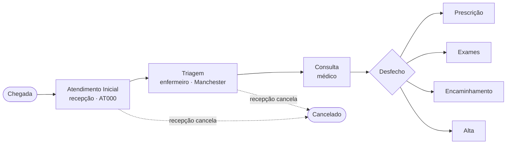
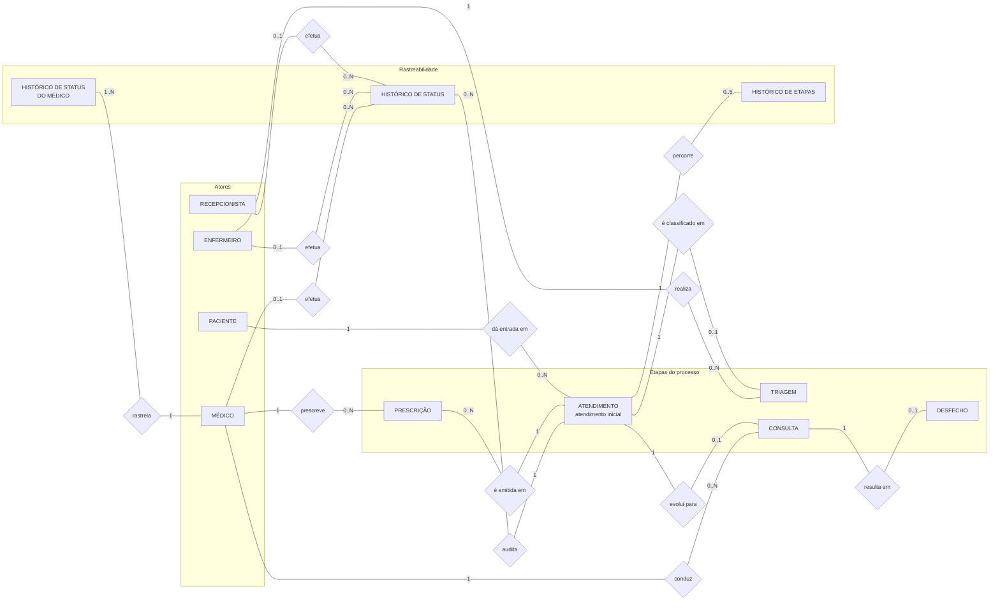
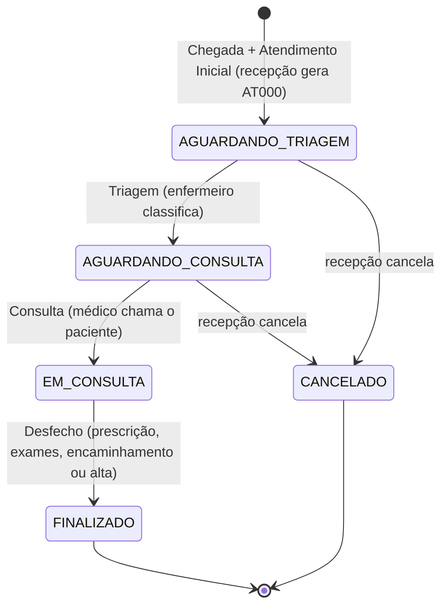
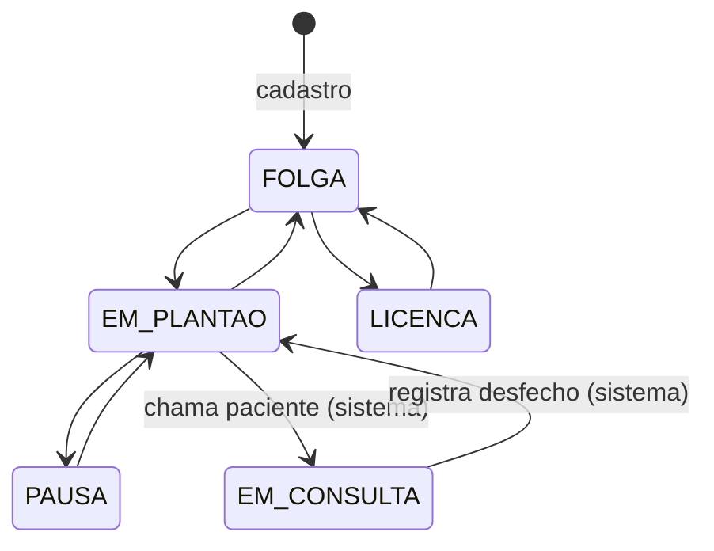

# MER — Modelo Entidade-Relacionamento (conceitual)

Sistema de Atendimento de Pronto-Socorro. O atendimento é um **processo em etapas**, não um ator:

```
Chegada → Atendimento Inicial → Triagem → Consulta → Desfecho/Finalização
                                                       ├─ Prescrição
                                                       ├─ Exames
                                                       ├─ Encaminhamento
                                                       └─ Alta
```

Fonte: `src/db/001_schema_base.sql` + migrations `010`, `011`, `012` e `013`.
O modelo lógico (tabelas, colunas, chaves, `NOT NULL`) está em [DER.md](DER.md) e o detalhamento de cada coluna em [DICIONARIO_DADOS.md](DICIONARIO_DADOS.md). Imagens: [img/MER.svg](img/MER.svg), [img/ciclo_atendimento.svg](img/ciclo_atendimento.svg) *(geradas antes da migration 013; a fonte atualizada são os diagramas Mermaid deste arquivo)*.

## Classificação das entidades

| Categoria | Entidades | Papel no modelo |
|---|---|---|
| **Atores** | Paciente, Recepcionista, Enfermeiro, Médico | Pessoas que participam do processo. Os três profissionais têm login próprio; o perfil de acesso vem da entidade em que estão (não há entidade "usuário"). |
| **Etapas do processo** | Atendimento *(Atendimento Inicial)*, Triagem, Consulta, Desfecho | Passos do fluxo do paciente. Cada etapa clínica aponta para o ator responsável por ela. |
| **Itens de etapa** | Prescrição | Detalhe do desfecho/consulta: um registro por medicamento. |
| **Rastreabilidade** | Histórico de Status, Histórico de Etapas, Histórico de Status do Médico | Trilhas de auditoria. Nunca são alteradas pela aplicação. |

**Chegada** não é uma entidade própria: é o instante em que o paciente entra no PS, gravado em `Atendimento.criado_em` e como primeira linha do Histórico de Etapas. **Atendimento** é a etapa de Atendimento Inicial (recepção, cadastro e número `AT000`) e o "envelope" que liga as etapas seguintes ao mesmo paciente.

## Fluxo do paciente



A recepção só cancela antes da Consulta (confirmação médica). Todos os desfechos finalizam o atendimento.

## Diagrama (notação de Chen)

Retângulo = entidade · losango = relacionamento · rótulo da aresta = cardinalidade. Os relacionamentos usam verbos que dizem **o que** acontece entre as entidades (não há "possui", "tem" ou "contém").



## Entidades e atributos

Legenda: **sublinhado** = identificador · *(s)* = dado sensível (RNF09) · *(opc)* = opcional (aceita nulo). Todo atributo sem *(opc)* é obrigatório (`NOT NULL` no DER).

### Atores

| Entidade | Atributos |
|---|---|
| **Paciente** | <u>id</u>, nome, endereco, cpf *(s, único, opc)*, rg *(s, opc, até 9)*, nome_pai *(opc)*, nome_mae *(opc)*, data_nascimento, criado_em |
| **Recepcionista** | <u>id</u>, nome, cpf *(s)*, rg *(s, opc, até 9)*, data_nascimento, telefone *(opc)*, email, login, senha_hash, ativo, ultimo_login_em *(opc)* |
| **Médico** | <u>id</u>, nome, cpf *(s)*, rg *(s, opc, até 9)*, data_nascimento, telefone *(opc)*, email, CRM (crm_numero + crm_uf, único), especialidade, **status_operacional** {EM_PLANTAO, EM_CONSULTA, PAUSA, FOLGA, LICENCA}, login, senha_hash, ativo, ultimo_login_em *(opc)* |
| **Enfermeiro** | <u>id</u>, nome, cpf *(s)*, rg *(s, opc, até 9)*, data_nascimento, telefone *(opc)*, email, COREN (coren_numero + coren_uf, único), categoria {ENFERMEIRO, TECNICO_ENFERMAGEM}, especialidade *(opc)*, status_disponibilidade {DISPONIVEL, PAUSA, INDISPONIVEL}, login, senha_hash, ativo, ultimo_login_em *(opc)* |

O `login` é único dentro de cada entidade e também entre as três (não existem dois profissionais com o mesmo login).

O **status operacional do médico** pertence ao Médico, não ao Atendimento. `EM_PLANTAO` permite chamar pacientes, `EM_CONSULTA` só o sistema define (ao chamar o paciente), e `PAUSA`, `FOLGA` e `LICENCA` são escolhidos pelo próprio médico. Médico desativado fica em `FOLGA` ou `LICENCA`.

### Etapas do processo

| Entidade | Atributos |
|---|---|
| **Atendimento** *(Atendimento Inicial)* | <u>id</u>, numero_atendimento (AT000, único), status {AGUARDANDO_TRIAGEM, AGUARDANDO_CONSULTA, EM_CONSULTA, FINALIZADO, CANCELADO}, criado_em *(= chegada)*, finalizado_em *(opc; preenchido se e só se FINALIZADO)*, atualizado_em |
| **Triagem** | <u>id</u>, classificacao_manchester {VERMELHO, LARANJA, AMARELO, VERDE, AZUL}, queixa_principal, pressão sistólica/diastólica *(opc)*, frequencia_cardiaca *(opc)*, frequencia_respiratoria *(opc)*, temperatura *(opc)*, saturacao_o2 *(opc)*, glicemia *(opc)*, escala_dor *(opc)*, observacoes *(opc)*, realizada_em |
| **Consulta** | <u>id</u>, iniciada_em *(= confirmação médica)*, finalizada_em *(opc; preenchida com o desfecho)* |
| **Desfecho** | <u>id</u>, tipo {PRESCRICAO, EXAMES, ENCAMINHAMENTO, ALTA}, descricao, destino_encaminhamento *(opc; obrigatório só em ENCAMINHAMENTO)*, registrado_em |
| **Prescrição** | <u>id</u>, medicamento, dosagem, via_administracao, frequencia, observacoes *(opc)*, criado_em |

Os status do Atendimento nomeiam a **etapa** em que o paciente está. Não indicam nada sobre o médico: quem conduz a consulta fica na entidade Consulta, e a situação do médico fica no próprio Médico.

### Rastreabilidade

| Entidade | Atributos |
|---|---|
| **Histórico de Status** | <u>id</u>, status_anterior *(opc; vazio na abertura)*, status_novo, data_hora |
| **Histórico de Etapas** | <u>id</u>, etapa {CHEGADA, ATENDIMENTO_INICIAL, TRIAGEM, CONSULTA, DESFECHO}, descricao (texto de até 255 caracteres), registrado_em |
| **Histórico de Status do Médico** | <u>id</u>, status_anterior *(opc; vazio no cadastro)*, status_novo, data_hora |

## Relacionamentos

| Relacionamento | Entidades | Cardinalidade | Regra |
|---|---|---|---|
| dá entrada em | Paciente — Atendimento | 1 : 0..N | Um paciente pode voltar ao PS várias vezes; cada atendimento é de um único paciente, com no máximo um atendimento em andamento por vez. |
| é classificado em | Atendimento — Triagem | 1 : 0..1 | Triagem única por atendimento e nunca existe sem ele (RNF04). |
| realiza | Enfermeiro — Triagem | 1 : 0..N | Só enfermeiro ativo da categoria ENFERMEIRO registra triagem (RF18). |
| evolui para | Atendimento — Consulta | 1 : 0..1 | A consulta nasce quando o médico chama o paciente (confirmação médica). A partir dela o atendimento não pode ser alterado nem cancelado (RF04, RF05). |
| conduz | Médico — Consulta | 1 : 0..N | Médico responsável imutável (RF19). Um médico conduz no máximo **1** consulta aberta por vez (RF20). |
| resulta em | Consulta — Desfecho | 1 : 0..1 | Desfecho único, registrado pelo médico da consulta. Sem desfecho a consulta não termina e o atendimento não finaliza (RF24). |
| é emitida em | Prescrição — Atendimento | 0..N : 1 | Uma linha por medicamento, só durante a consulta; nunca existe sem atendimento (RNF04). Desfecho PRESCRICAO exige ao menos uma. |
| prescreve | Médico — Prescrição | 1 : 0..N | Só o médico da consulta prescreve (RF21). |
| audita | Histórico de Status — Atendimento | 0..N : 1 | Uma linha por mudança de status (RF14/RF23). |
| efetua | Recepcionista / Enfermeiro / Médico — Histórico de Status | 0..1 : 0..N (cada) | Quem fez a mudança de status. Cada registro tem **exatamente um** responsável, de uma das três entidades. |
| percorre | Atendimento — Histórico de Etapas | 1 : 0..5 | Uma linha por etapa percorrida, cada etapa no máximo uma vez, com a descrição textual do que aconteceu (RF25). |
| rastreia | Histórico de Status do Médico — Médico | 1..N : 1 | Toda mudança de status operacional do médico, gravada automaticamente pelo banco (RF26). |

## Ciclo de vida do Atendimento



A partir da Consulta (confirmação médica) o atendimento não pode ser alterado nem cancelado (RF04, RF05, RNF05). Depois de FINALIZADO, é imutável (RF15), e o desfecho também.

## Ciclo do status operacional do Médico



Fora de `EM_CONSULTA`, o médico escolhe livremente entre `EM_PLANTAO`, `PAUSA`, `FOLGA` e `LICENCA`. O diagrama mostra as transições usuais. Enquanto estiver `EM_CONSULTA`, o médico não muda de status nem pode ser desativado.
